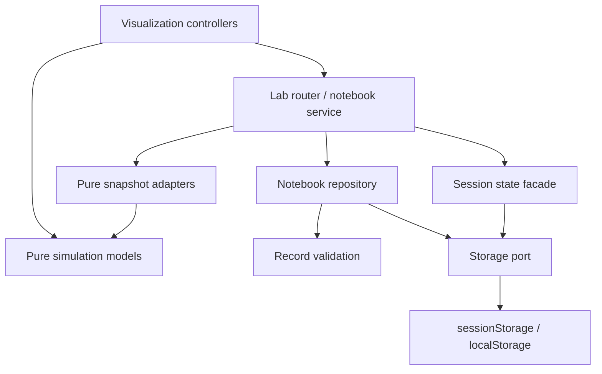

# Architecture and backend extension points

The site is static HTML, CSS and ordinary browser JavaScript. It opens locally without a bundler. Node scripts exist only for tests, local preview and packaging; no Node server is deployed.

## Responsibilities

| Layer                         | Location                                                                                                                                     | Responsibility                                                                                                    |
| ----------------------------- | -------------------------------------------------------------------------------------------------------------------------------------------- | ----------------------------------------------------------------------------------------------------------------- |
| Pure simulation               | `assets/js/models/matmul.js`, `performance/*models.js`                                                                                       | Numerical results, address/resource estimates, scheduling and pipeline geometry                                   |
| Reference data                | `architecture-data.js`, `performance/diagnosis-data.js`, `core/module-catalog.js`                                                            | Hardware descriptions, quiz cases and module metadata                                                             |
| Visualization and interaction | Page controllers, `architecture-hardware.js`, `performance/{memory,occupancy,scheduler,roofline,mapping,blocking,pipeline,tree,notebook}.js` | DOM/canvas/SVG rendering, inputs and playback                                                                     |
| Common UI                     | `core/lab-ui.js`, shared CSS                                                                                                                 | Escaping, headings, metric cards and visual conventions                                                           |
| Routing and orchestration     | `performance/lab.js`, `performance/notebook-service.js`                                                                                      | Mount/cleanup, session state, snapshot actions and restore navigation                                             |
| Snapshot adapters             | `performance/experiment-adapters.js`                                                                                                         | Describe any lab as a record; validate and return a restorable configuration, without touching the DOM or storage |
| Record schema                 | `performance/notebook-records.js`                                                                                                            | Versioned validation/import, nullable metrics, comparison deltas                                                  |
| Notebook repository           | `performance/notebook-store.js`                                                                                                              | Create/read/write validated records through an injected storage port                                              |
| Browser storage boundary      | `core/storage.js`, `core/session-state.js`                                                                                                   | Session/persistent scopes, cached fallback, raw storage access and saved module state                             |
| Packaging and checks          | `scripts/`, `tests/`                                                                                                                         | Public-only staging, isolated Chrome tests and repository-path compatibility                                      |



All actual browser-storage access is in `core/storage.js`. Keys retain the existing `diescope.performance.*` and `diescope.notebook.v1` namespaces so saved data on the same origin continues to work. State never stores canvas pixels, DOM nodes, running timers or executable code. Notebook restores pass through model-specific validation.

The CPU/GPU and grid controllers retain their existing in-page camera/layout/selection behavior. This refactor does not silently persist those entire graphs. Performance Lab settings remain session-scoped; notebook records remain persistent. The Matrix Lab's numerical model is independent of its rendering/controller, and the blocking controller is reused on both Matrix and Performance pages.

## Storage port contract

`StoragePorts.createStorage({session, persistent})` accepts synchronous providers with the Web Storage shape: `getItem(key)`, `setItem(key, serializedValue)`, `removeItem(key)`. Providers may be lazy functions, which also handles browsers that deny access to the storage objects themselves.

The application-facing port has:

```js
storage.read("persistent", key); // { value: string | null, durable, error }
storage.write("persistent", key, json); // { value, durable, error }
storage.remove("persistent", key); // { value: null, durable, error }
```

Failed writes retain the latest value in memory instead of reading stale browser data. The notebook reports that changes last only in the current tab and keeps JSON export available. A corrupt stored notebook is left untouched until the user explicitly saves.

Tests inject memory providers and deterministic IDs/timestamps. Rendering controllers do not need to know which browser storage implementation is used.

## Adding a backend later

Keep the simulations in the browser. Extend the notebook service/repository with an **asynchronous synchronization layer** when accounts, cross-device saves or shared experiments become requirements. Local synchronous storage can remain a responsive cache; do not put `fetch()` inside `getItem()` and pretend it returns synchronously.

A remote service will need explicit authentication, record ownership, schema validation, revisions/update timestamps, and a conflict/offline policy. Decide these when implementing that service. The current creation timestamp is not a conflict-resolution revision. No backend API, account system or placeholder network requests are implemented now.

If a different persistent repository is introduced, change `notebook-service.js` to compose it with the same snapshot adapters and validated records. The visualizers' simulation math and drawing code can stay intact.

JSON export/import transfers notebooks between localhost and the hosted site. Browser storage is origin-specific, so moving from localhost to a GitHub domain does not automatically move saved records. On shared GitHub Pages origins, retaining the same storage namespace also means deployments of this same app share those keys; choose an explicit namespace if you later need isolated installations.

## Static deployment

`scripts/stage-site.cjs` copies HTML, `assets/`, kernels and `.nojekyll` into `dist/site/`. It deliberately excludes tests, docs, scripts, package metadata and unrelated repository files. It performs no source transformations, so the tested artifact is the deployed artifact.

All local links use relative paths. The isolated browser runner serves **only** the configured prefix when testing a project site, so an accidental `/assets/...` reference fails rather than being rescued by a second root route. Tests cover both `/` and `/cuda-learning-visualizer/`.

The repository's `.github/workflows/visualizer.yml` checks each push/PR, stages the public artifact and deploys only successful runs on the default branch. It grants Pages write permissions only to the deployment job. Node 24 and Chrome are test tooling, not runtime dependencies.
